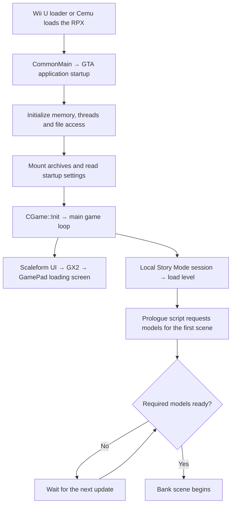
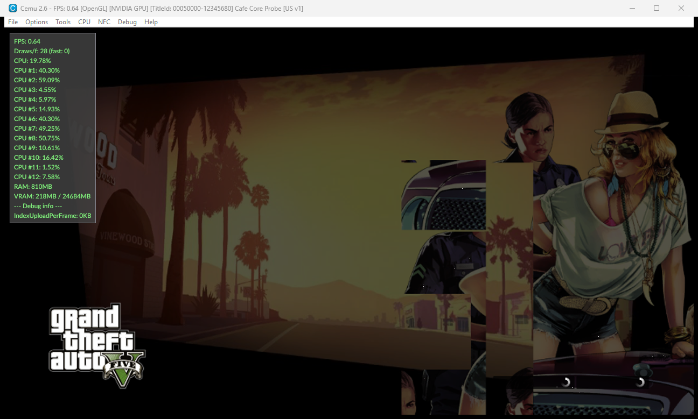
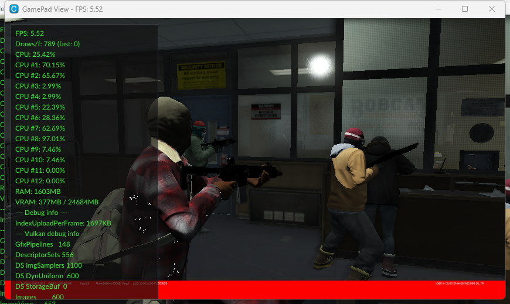
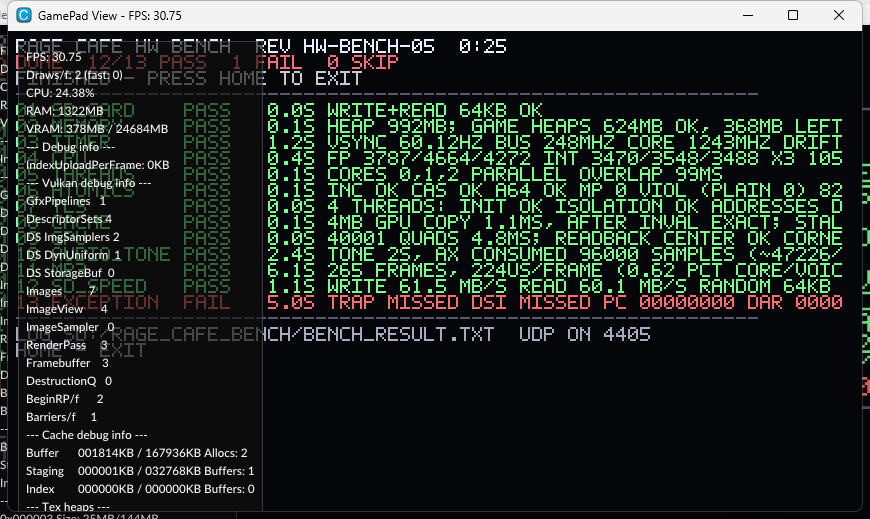

*Rage Internals / WiiU Internals · Part 1*

I had a Wii U at home gathering dust. I wanted to play GTA V on that particular machine, to pick up the GamePad and pull off the North Yankton heist on its little screen. The game had come out on PS3, after all. That hardly meant it would just run on Wii U, but the idea stuck.

The first thing my port showed me was a black Cemu window and exit code 1. It was October 11, and for once I was happy to see it. I'd put the stop there myself, and the game's original entry point had left a marker in the log just before it. There was nothing to play yet, but I knew which line to tackle next.

## First, make it stop in the right place

I started with the newer-generation GTA V code and the PS3 game data. I wanted the regular single-player story, with the same missions, physics and characters. I wrote a Cafe layer for Wii U that the game uses to open files, allocate memory, read buttons and draw to the screen.

At first the build tripped over little things like backslashes in header paths. Later the compiler produced object files, but the RPX packager still couldn't turn them into something the Wii U could run. Getting the code to compile was one milestone. Seeing it actually execute was another.

For the first run I put a stop right before system initialization. I logged three things: entry into the application, arrival at initialization and the planned stop. A missing marker narrowed down where to look.

*This standalone C++17 example checks the actual markers from my run. It reads the log after the fact.*

```cpp
#include <initializer_list>
#include <string_view>

// Look for each log marker in order.
bool reached_planned_stop(std::string_view log) {
    for (const auto marker : {
             "GTA_APPLICATION_ENTRY",
             "GTA_CAPP_INITSYSTEM_ENTER",
             "GTA_CAPP_FIRST_UNLINKED service=CSystem::Init",
             "FATAL_NATIVE_RETURNED fallback=coreinit.exit(1)"}) {
        const auto pos = log.find(marker);
        if (pos == std::string_view::npos)
            return false;
        log.remove_prefix(pos + std::string_view{marker}.size());
    }
    return true;
}
```

Exit code 1 alone told me very little. A planned stop and an ordinary crash could both end that way, so I checked the markers and the order they appeared in.

## What I had on my workbench

I built on Windows through WSL. **CMake and Ninja** managed the build, **devkitPPC** compiled the PowerPC code, **wut** provided access to the console APIs, and **elf2rpl** turned the ELF into a Wii U executable. I ran the first builds in **Cemu 2.6** with the interpreter.

My own tools included a separate build target for early startup, a toolchain wrapper and a log collector. I checked the RPX hash before digging into a run. It's all too easy to fix a bug, accidentally launch yesterday's build and spend another hour wondering why nothing changed. For the game data I wrote an archive packer and a PS3-to-GX2 texture converter.

**How the game starts.** This is the map I used for debugging. The arrows show what each step depends on. The loading screen can keep spinning while the world loads in the background.



On October 11 I'd only reached the call to initialize the system. By October 21, **CGame::Init** was completing in Cemu. The build linked 4,055 object files with zero unresolved symbols. I still didn't have a single frame of the loading screen. That put the green build log in perspective.

## The first pixel came from a spinner

For my first check I picked the loading spinner. A test pattern would have told me GX2 could draw something. I wanted to see the whole chain work: the game fetching its own texture from an archive and my code putting it on screen.

It's easy to have all the right bytes in the wrong order. Take pixel E in a 4×4 grid. It starts the second row, but its position in memory depends on the layout.

| Layout of the 4×4 grid | First eight elements in memory | Index of **E** |
|---|---|---:|
| Row by row | `A B C D E F G H` | 4 |
| In 2×2 tiles | `A B E F C D G H` | 2 |

In both images the top row reads `A B C D` and the next reads `E F G H`. The indices start at zero.

*The 2×2 tiles are a made-up example. The actual GX2 layout is more involved.*

I worked out the layout by comparing my converter's calculations on the PC with the values GX2 returned in Cemu. For a compressed texture, for example, the row pitch was measured in blocks instead of pixels. Then I drew test textures and read the results back. In one test, 54 of the 57 texture levels matched. The other three gave me specific cases to work through.

I did the same check with the real spinner, reading back the rendered image and sampling six points. All six matched. There was still a long way to go before I'd see GTA on screen, but one asset had made it all the way from archive to pixels.

## A frame was presented. Where was the picture?

Once the main loop was running, I thought the renderer was broken. The frame counter kept ticking and the window stayed black. It turned out there was nothing to draw yet. The game looked in the platform archive for the startup settings. My data set had them in the common archive. That file told the game where to find the UI, fonts and loading screen. I kept the platform path as the first choice and added a fallback to the common archive. The loader finally reached the UI assets. On October 22 the first frame from the game's own loading screen showed up in the log.

At one point all I could see was a pair of white lines. They looked like broken letters, but the draw calls told a different story. The lines were a border. The game drew the letters separately. I checked the shader instructions too, and the glyph coordinates were correct. The glyph texture itself wasn't updating. It was full of zeroes, which meant every glyph was fully transparent. I fixed the texture update and the text appeared.



*October 23, Cemu. A frame from the build showing the logo and spinners. The counter in the corner belongs to this emulator run.*

## The game was alive. The prologue was waiting for a light

The loading screen could sit there even while the game kept running. I checked how far the mission had progressed and which object it was requesting. The prologue was waiting for a lighting prop for the opening scene. The PS3 data didn't include it. I could have left Cemu running overnight and it would still have been waiting for that light in the morning.

*I wrote this small C++ model for the article. The names and structure are mine. In the game, the asset loader reports when the prop is ready.*

```cpp
enum class AssetState { Missing, Loading, Resident };
enum class IntroStage { WaitForLights, PlayIntro };

IntroStage tick_intro(IntroStage stage, AssetState lights) {
    if (stage == IntroStage::WaitForLights &&
        lights == AssetState::Resident) {
        return IntroStage::PlayIntro;
    }
    return stage;
}
```

| What the loader reports | What happens on the next frame |
|---|---|
| Object missing from the package | The script stays in `WaitForLights`. A minute later it's still there. |
| Object found and still loading | The script keeps waiting. The object is on disk but isn't ready for the scene yet. |
| Object loaded | The script moves on to `PlayIntro`. |

I converted the missing assets from the PC version and added their definitions to the package. The mission condition stayed the same. The script got its lights and moved on.



*The prologue in Cemu's GamePad window in October. This was a separate run. The green numbers on the left are the emulator's.*

## Why I wrote RAGE HW Bench

By early November I'd seen the bank in Cemu. I wanted to find out which of my assumptions held up on the Wii U that had started all this. Loading the entire prologue to find out whether the CPU could see what the GPU had just written got old fast. That's how **RAGE Cafe HW Bench** came about. It's a standalone C++ program that I packaged as a WUHB and ran from the Aroma menu.

I kept it simple. Each entry in a C++ table holds a test name and a function pointer. The test returns its result, and shared code handles timing and display. The GamePad and TV show the test name before the call, then the result and elapsed time. Each line is flushed to the SD card immediately, and the PC can receive a copy over UDP. Even if the console hangs, the last line tells me which test was running. The **hw-bench-05** build had 13 checks, covering everything from SD writes and all three CPU cores to GX2 rendering and audio playback. For audio I started with two seconds of a 440 Hz tone. My ears could tell me more than a PASS on screen.

The cache test earned its keep. First I had the CPU read an empty buffer so its cache held zeroes. Then I had the GPU copy 4 MiB of known data into the buffer and waited for the copy to finish. It seemed safe to read. Here's what **the Wii U itself recorded on November 3**.

| When the CPU read the buffer | What it saw |
|---|---|
| As soon as the GPU finished | The CPU still saw the old value at 2 of the 131,072 locations checked. |
| After invalidating the CPU cache for the buffer | I checked all 1,048,576 words. Every one matched. |

Those two words were worth writing the benchmark for. I'd read the advice about invalidating the cache. Now I'd waited for the GPU, read the memory and seen an old zero exactly where it had no business being. The next time a texture looked odd, I had a test I could come back to and just a few lines of log to check.

The Wii U passed **13 out of 13** on that run. The same build passed **12 out of 13** in Cemu. In the exception test, the application's handler didn't receive the expected events. That's why I keep the console on my desk even when the emulator is already showing me the game.



*November 2, RAGE Cafe HW Bench in Cemu. Twelve of thirteen tests passed. The red line is the exception test. The 13/13 hardware result above came from a separate run on Wii U.*

## One last bug: Michael wouldn't take out his phone

Later in the prologue, Michael is supposed to pull out his phone, open his contacts and set off the charge on the vault door. The charge is an ordinary in-game prop with its own 3D model. The phone wouldn't open. Watching the GamePad, you'd think I'd mapped the button wrong.

I logged the mission stage, the model lookup result and the point where the mission lets Michael use the phone. The log showed that the game had reached the right stage. Then it kept requesting one of the charge models. The loader reported that the object wasn't even on its list. The mission never got far enough to enable the phone.

I brought over the missing models from the PC version and ran the same RPX again. First the model showed up in the log, then the mission enabled the phone, and the contacts prompt appeared on screen. The mission code was identical across both runs. I didn't test the explosion that time. There was Michael in Cemu's GamePad window, phone in hand, with a prompt in the corner telling me to open his contacts. For the first time that run, I glanced at the corner of the screen to see which button to press next. The log could wait.
