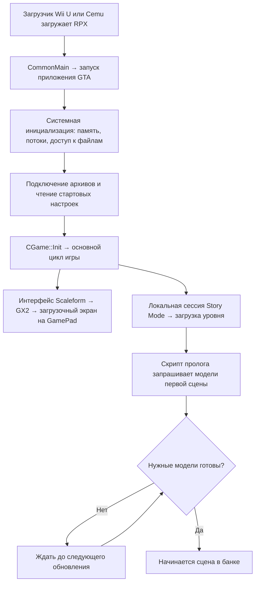
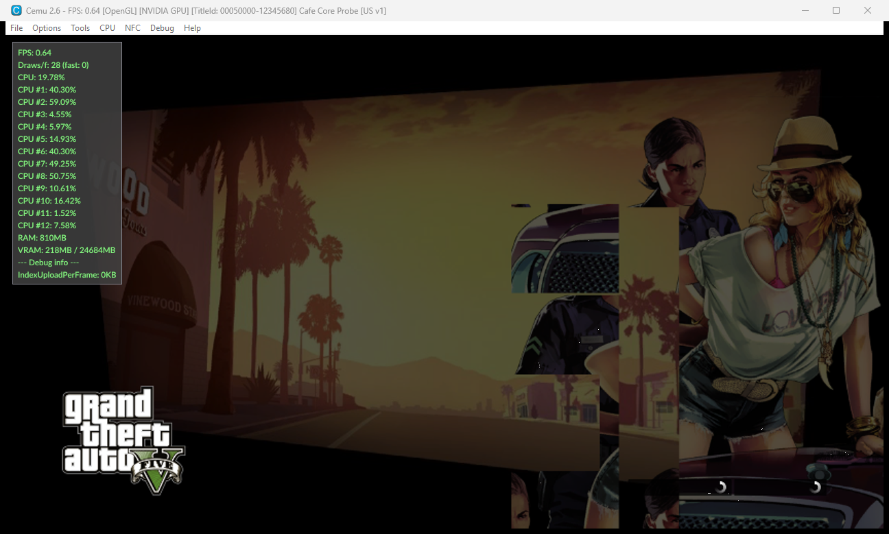
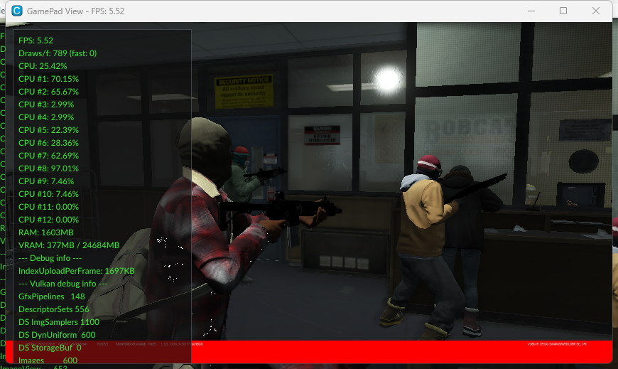
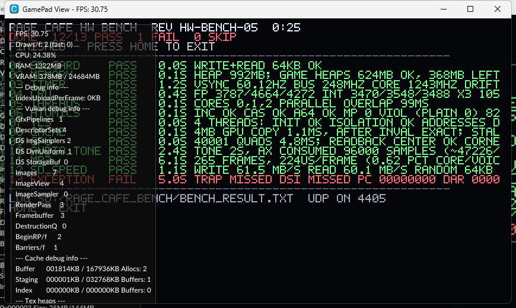

*Rage Internals / WiiU Internals · Часть 1*

У меня дома валялась Wii U и глотала пыль. А мне хотелось поиграть на ней в GTA V. Именно на ней: взять GamePad в руки и пройти ограбление в Северном Янктоне на его маленьком экране. На PS3 игра ведь выходила. Понятно, что от этого она на Wii U сама не заведётся, но мысль уже засела.

Первое, что я увидел от своего порта, — чёрное окно Cemu и код выхода 1. Дело было 11 октября. На этот раз я даже обрадовался: остановку поставил сам, а перед ней в логе отметилась оригинальная точка входа игры. Играть было пока не во что, но я уже знал, с какой строчки продолжать.

## Сначала — пусть упадёт там, где надо

Я взял код GTA V нового поколения и данные от PS3. Хотел запустить обычную сюжетку без онлайна, с теми же миссиями, физикой и персонажами. Для Wii U сделал свой слой Cafe: через него игра открывает файлы, выделяет память, читает кнопки и рисует.

Поначалу сборка ломалась на мелочах вроде обратных слешей в путях к заголовкам. Потом компилятор уже выдавал объектные файлы, а упаковщик RPX всё ещё не мог собрать из них файл, который запустит Wii U. Одно дело — собрать код, другое — увидеть, что он вообще начал выполняться.

Для первого запуска я поставил стоп прямо перед системной инициализацией. В лог вывел три вещи: вход в приложение, начало инициализации и остановку в нужном месте. Если какой-то отметки нет, уже понятно, где искать.

*Пример на C++17: самостоятельная проверка по реальным меткам моего прогона. Это код для разбора лога; внутри движка он не выполняется.*

```cpp
#include <initializer_list>
#include <string_view>

// Сокращённая проверка лога: поиск меток строго по порядку.
bool reached_planned_stop(std::string_view log) {
    for (const auto marker : {
             "GTA_APPLICATION_ENTRY",
             "GTA_CAPP_INITSYSTEM_ENTER",
             "GTA_CAPP_FIRST_UNLINKED service=CSystem::Init",
             "FATAL_NATIVE_RETURNED fallback=coreinit.exit(1)"}) {
        const auto pos = log.find(marker);
        if (pos == std::string_view::npos)
            return false;
        log.remove_prefix(pos + std::string_view{marker}.size());
    }
    return true;
}
```

По одному коду выхода тут ничего не поймёшь. И запланированный стоп, и обычный вылет могут закончиться кодом 1. Поэтому я проверял сами метки и их порядок.

## Что было в моей мастерской

Собирал на Windows через WSL: **CMake и Ninja** управляли сборкой, **devkitPPC** компилировал код под PowerPC, **wut** давал доступ к API консоли, а **elf2rpl** делал из ELF файл для Wii U. Первые запуски гонял в интерпретаторе **Cemu 2.6**.

Из своего — отдельная цель сборки для раннего запуска, обёртка вокруг тулчейна и сборщик логов. Я сверял хеш RPX перед разбором прогона: иначе легко починить баг, случайно запустить вчерашнюю сборку и ещё час искать, почему ничего не изменилось. Для данных сделал упаковщик архивов и конвертер текстур PS3 → GX2.

**Как запускается игра.** Ниже моя карта для отладки. Стрелки показывают, от чего зависит следующий результат; экран загрузки может крутиться, пока в фоне уже грузится мир.



11 октября я дошёл только до вызова системной инициализации. К 21 октября в Cemu уже завершалась **CGame::Init**: в сборке сошлись 4055 объектных файлов, линкер не оставил ни одного неразрешённого символа. А загрузочного кадра всё ещё не было. Эта разница здорово отрезвляет, когда смотришь на зелёный лог сборки.

## Первый пиксель — со спиннера

Для первой проверки я взял спиннер из загрузочного экрана. Можно было нарисовать тестовую картинку и убедиться, что GX2 вообще рисует. Но мне хотелось проверить всю цепочку: игра сама достаёт текстуру из архива, а мой код показывает её на экране.

Тут легко наступить на грабли: правильные байты можно положить в неправильном порядке. На сетке 4×4 это видно сразу. Я покажу это на примере пикселя E: он стоит в начале второй строки, но позиция в памяти зависит от раскладки.

| Раскладка сетки 4×4 | Первые восемь элементов в памяти | Индекс элемента **E** |
|---|---|---:|
| По строкам | `A B C D E F G H` | 4 |
| Плитками 2×2 | `A B E F C D G H` | 2 |

В обоих случаях верхняя строка изображения — `A B C D`, а следующая — `E F G H`. Индексы начинаются с нуля.

*Схема показывает принцип на вымышленных плитках 2×2. Реальная раскладка GX2 устроена сложнее.*

Раскладку я разбирал на практике: сравнивал расчёты конвертера на ПК с тем, что возвращал GX2 в Cemu. Например, для сжатой текстуры ширина строки в памяти считалась в блоках, а не в пикселях. Дальше я рисовал тестовые текстуры и считывал результат обратно. В одном из тестов совпали 54 из 57 проверенных уровней текстур. Три оставшихся дали мне конкретные случаи, на которых можно было искать ошибку в раскладке.

С настоящим спиннером сделал ту же проверку: прочитал отрисованную картинку и сравнил шесть точек. Все шесть совпали. До GTA на экране оставалось ещё много работы, зато один ресурс уже прошёл путь от архива до пикселей.

## Кадр «выведен». А где картинка?

Когда основной цикл заработал, возникло ощущение, что сломался рендер: счётчик кадров шёл, окно оставалось чёрным. Но оказалось, рисовать пока нечего. Игра искала стартовый файл настроек в архиве платформы, а в моём наборе он лежал в общем архиве. Именно этот файл подсказывал, где взять интерфейс, шрифты и загрузочный экран. Оставил платформенный путь первым, а если файла там нет — добавил поиск в общем архиве. После этого загрузчик наконец добрался до ресурсов интерфейса. 22 октября в логе появился первый штатный загрузочный кадр.

Однажды в окне остались две белые черты. Их легко было принять за сломанные буквы. Но по командам рисования было видно: черты были рамкой, а буквы игра рисовала отдельно. Заодно посмотрел машинные инструкции шейдера: координаты букв считались правильно. Проблема была проще — текстура с буквами не обновлялась. В ней оставались нули, а ноль там означает «полностью прозрачно». Починил обновление текстуры, и текст появился.



*23 октября, Cemu. Реальный кадр сборки: видны логотип и спиннеры. Счётчик в углу относится к этому запуску в эмуляторе.*

## Игра жива, а пролог ждёт лампу

Заставка могла висеть, хотя игра продолжала работать. Я посмотрел, до какого шага дошла миссия и какой объект она запрашивала. Оказалось, пролог ждёт реквизит с источниками света для первой сцены. В PS3-данных такого объекта не было. Можно было оставить Cemu на ночь, и к утру он всё ещё ждал бы тот же свет.

*Пример на C++: маленькая модель этого ожидания, написанная для статьи. Названия и структура здесь свои; в игре готовность сообщает штатный загрузчик.*

```cpp
enum class AssetState { Missing, Loading, Resident };
enum class IntroStage { WaitForLights, PlayIntro };

IntroStage tick_intro(IntroStage stage, AssetState lights) {
    if (stage == IntroStage::WaitForLights &&
        lights == AssetState::Resident) {
        return IntroStage::PlayIntro;
    }
    return stage;
}
```

| Что сообщает загрузчик | Что происходит на следующем кадре |
|---|---|
| Объекта нет в пакете | Скрипт остаётся на `WaitForLights`. Через минуту ничего не изменится. |
| Объект найден и ещё грузится | Скрипт ждёт загрузки. На диске он есть, но в сцену его пока не поставить. |
| Объект загружен | Скрипт переходит к `PlayIntro`. |

Я конвертировал нужные ресурсы из PC-версии и добавил их описания в пакет. Условие в миссии осталось прежним: скрипт дождался света и пошёл дальше.



*Октябрьский кадр пролога из окна GamePad в Cemu. Он из отдельного прогона; зелёные цифры слева относятся к эмулятору.*

## Зачем я написал RAGE HW Bench

К началу ноября я уже видел банк в Cemu. Теперь хотелось понять, что из моих предположений выдержит встречу с той самой Wii U. Грузить пролог целиком, чтобы узнать, видит ли процессор то, что только что записала видеокарта, — удовольствие так себе. Так появился **RAGE Cafe HW Bench**: отдельная программа на C++, которую я упаковал в WUHB и запускал из меню Aroma.

Устроил её просто: в C++ завёл таблицу тестов, у каждого — имя и указатель на функцию. Сам тест возвращает результат, а общий код ведёт таймер и рисует экран. Перед вызовом на GamePad и телевизоре загорается строка с названием, после — результат и время. Каждую строку программа сразу сбрасывает на SD; копию можно получать на ПК по UDP. Даже если консоль зависнет, последняя строка подскажет, какой тест шёл. В сборке **hw-bench-05** было 13 проверок: от записи на SD и работы трёх ядер до рисования через GX2 и воспроизведения звука. Для звука я начал с двух секунд тона 440 Гц: уши тут полезнее надписи PASS.

Больше всего мне пригодился тест кэша. Я дал CPU заранее прочитать пустой буфер, чтобы в его кэше остались нули. Потом попросил GPU скопировать туда 4 МиБ знакомых данных и дождался окончания копирования. Казалось бы, можно читать. Вот что записала **сама Wii U 3 ноября**:

| Когда читал CPU | Что оказалось в буфере |
|---|---|
| Сразу после завершения работы GPU | В 2 из 131 072 проверенных мест CPU всё ещё видел старое значение. |
| После инвалидации кэша CPU для этого буфера | Проверил уже все 1 048 576 слов. Ни одного расхождения. |

Вот ради этих двух слов и стоило писать бенч. Одно дело — прочитать в документации, что надо инвалидировать кэш. Другое — дождаться GPU, прочитать память и увидеть старый ноль ровно там, где его уже быть не должно. Теперь у меня был тест на несколько строк лога, к которому можно вернуться, если очередная текстура ведёт себя странно.

В том прогоне Wii U прошла **13 из 13**. Та же версия в Cemu прошла **12 из 13**: в проверке исключений обработчик приложения не получил ожидаемые события. Удобное напоминание, зачем на столе нужна настоящая консоль, даже когда игра уже показывает картинку в эмуляторе.



*2 ноября, RAGE Cafe HW Bench в Cemu: 12 из 13 тестов. Красная строка — проверка исключений. Аппаратный результат 13/13 выше взят из отдельного прогона на Wii U.*

## Последний баг этой истории: Майкл не достаёт телефон

Позже в прологе Майкл должен достать телефон, открыть контакты и по сюжету взорвать заряд на двери хранилища. Заряд — обычный игровой предмет со своей 3D-моделью. Вот только телефон не открывался. Со стороны выглядело так, будто я неправильно привязал кнопку GamePad.

Я добавил в лог номер этапа миссии, результат поиска модели и момент, когда миссия разрешает достать телефон. По этим строкам стало видно, что до нужного этапа игра дошла. Дальше она снова и снова запрашивала одну из моделей заряда. Загрузчик отвечал, что такого объекта даже нет в списке. До разрешения открыть телефон дело просто не доходило.

Перенёс недостающие модели из PC-версии и прогнал тот же RPX ещё раз. В логе сначала появилась модель, затем миссия разрешила открыть телефон, а на экране вылезла подсказка про контакты. Код миссии между прогонами не менялся. Сам взрыв я в том тесте не проверял. В окне GamePad в Cemu стоял Майкл с телефоном в руке, а в углу висело предложение открыть контакты. И тут я впервые за этот прогон посмотрел в угол экрана, чтобы узнать, какую кнопку жать дальше. Лог мог подождать.
